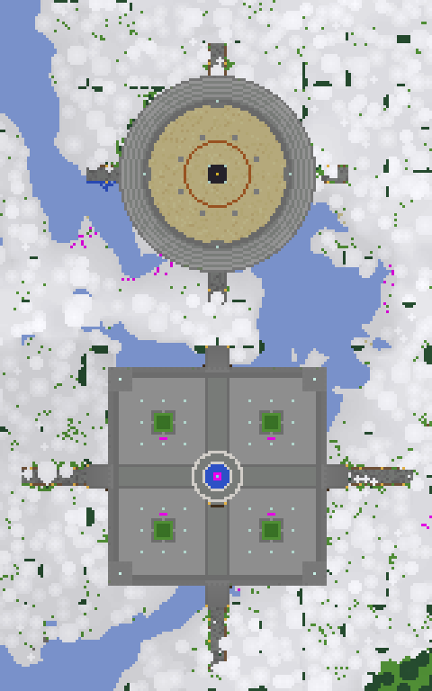

# Crispy Factions

Sub-server on the CrispyAnarchy network (Velocity). 1.8-era combat, classic cannon/obsidian raiding,
prime-time raid windows, no pay-to-win.

| | |
|---|---|
| AMP instance | `Factions01` (start on boot), panel port 8089 |
| Engine | Paper **1.21.11** (build 132), Java 21, 6 GB heap |
| Game port | `127.0.0.1:25572` — reachable only through Velocity (`factions` server) |
| RCON | `127.0.0.1:25581`, password in `/root/factions_rcon_password.txt` on the VM |
| Lobby | DeluxeHub server selector, slot 13 (TNT icon) → `[PROXY] factions` |

> FactionsUUID 4.7.x is a paid Spigot resource, so the server runs **SaberFactions 4.1.9**, a free
> FactionsUUID fork with the same `/f` commands, power system and roles. SaberFactions is tested up
> to MC 1.21, which is why the engine is Paper 1.21.11 (newer clients join via ViaVersion).

## Plugin stack

| Plugin | Version | Role |
|---|---|---|
| OldCombatMechanics | 2.7.0 | 1.7/1.8 combat |
| SaberFactions | 4.1.9 | factions, claims, power |
| EssentialsX (+Chat, +Spawn) | 2.22.0 | economy, kits, homes, `/craft`, `/echest` |
| Vault | 1.7.3 | economy bridge |
| LuckPerms | 5.5.87 | ranks |
| EconomyShopGUI | 7.3.2 | `/shop` |
| Chunky | 1.4.40 | pre-generation |
| mcMMO | 2.3.002 | RPG skills (built from the GPL source, commit 25474dc) |
| ViaVersion / ViaBackwards | 5.12.x | newer clients |
| **CrispyFactions** (custom) | 1.3.1 | raid window, obsidian durability, Aegis Star, collector hopper, item bans, `/nv`, AFK, combat tag, cases, votes |
| HMCWraps | — | *not installed*: download from SpigotMC/Polymart and drop into `plugins/` |

`install_plugins.sh` downloads everything except HMCWraps; `configure.py` applies every setting below.

## 1. Combat (OldCombatMechanics)
- All worlds locked to the `old` modeset: no attack cooldown, sword blocking (Paper consumable animation),
  old potion values + 1.8 splash throwing, old armour strength, no sweep, old tool damage/crits/regen.
- `disable-offhand` always on (no shields/totems in the offhand); shield, mace and end-crystal crafting denied.
- CrispyFactions additionally blocks: elytra gliding (and wearing), tridents (throwing + melee), mace and
  netherite weapons in PvP, netherite smithing upgrades, wearing netherite armour, totem resurrection,
  end-crystal placement outside the End, and end-crystal damage to players.

## 2. Factions & raiding
- SaberFactions: 15 members max, no alts, power 10 / -10, -2 per death, +0.2/min, no offline regen.
- Disabled: `/f fly`, `/f tnt` bank + tntfill, `/f upgrades`, `/f chest`, `/f vault`, `/f missions`, `/f alts`, grace.
  `factions.fly` / `factions.tnt` are also denied in LuckPerms.
- Obsidian durability (CrispyFactions): **5 TNT hits or 3 creeper hits** (charged creepers count double),
  radius 3. Obsidian touching water/lava is immune and TNT that explodes in water does nothing, so watered
  walls need sand+TNT hybrid cannons. Damage is forgotten after 30 min without a hit. No regen walls, no genbuckets.
- Cannon physics: falling-block / TNT height nerfs off, TNT moves in water, `max-tnt-per-tick: 500`,
  `optimize-explosions: true`.
- Locator bar (player dots in the XP bar) off: `gamerule minecraft:locator_bar false` in all three worlds.
- Phantoms off: `gamerule minecraft:spawn_phantoms false` in all three worlds.
- World borders: overworld 5000×5000 (±2500), nether 2500×2500. Both pre-generated with Chunky.

## 3. Prime-time raid window (America/New_York) — currently OFF

> The schedule is switched off (`raid-window.enabled: false` in `plugins/CrispyFactions/config.yml`):
> claims can be raided at any time, and an Aegis Star simply protects for 25 real hours (it can be
> activated any time; the 14-day cooldown and pacifism lock still apply). Set it to `true` and run
> `/crispyfactions reload` to bring back the schedule below.

| Days | Raid window |
|---|---|
| Mon–Fri | 18:00 – 23:00 |
| Sat–Sun | 12:00 – 24:00 |

Outside the window, explosions deal **0 damage to blocks inside faction claims** (obsidian included).
Wilderness/warzone PvP and farming are unaffected. Warnings at 60/15/5/1 min, title + broadcast on open/close.
`/raidwindow` (`/rw`) shows status. Admin override: `/raidwindow force open|closed|auto`.

## 4. Aegis Vacation Star
- Item: glinting nether star `✦ Aegis Vacation Star (25 Raid-Hours) ✦`.
- `/kit aegis`: free once per 14-day cycle; cycles start every other Friday from **2026-10-16**
  (`aegis.kit.first-friday`). Requires **10 h playtime**.
- `/shop` → Specials: **$2,500,000**.
- Right-click inside your own claim as Leader/Co-Leader during peacetime → banks **25 raid-window hours**
  (ticks only while the window is open = 5 weeknights).
- Guardrails: not during a window or within **6 h** of one opening; one active per faction;
  **14-day** faction cooldown after it expires.
- Pacifism lock while active: members can't ignite TNT or place creepers in enemy territory, and
  dispensers in the faction's own land won't fire TNT/creeper eggs.
- `/aegis` shows status; admin `/aegis give <player> [n]`, `/aegis collector <player> [n]`, `/aegis reset <faction>`.

## 5. Economy (`/shop`)
Only the three sell tables (Farm, Ore, Mob Drop) pay out; all other sale prices were removed from the default shop.
Sell with `/sellall` or `/sellgui`. Every sell price was checked against every buy price in the shop, including blocks
that craft, smelt, scrape or break back into the item, so nothing can be bought and resold for profit.
Left out on purpose:
- copper: a waxed or oxidised copper block scrapes back into 9 ingots;
- emeralds: villagers pay them for cheap shop stone and sticks;
- iron: it stays in Phase 2.

Drops that can be farmed in bulk (kelp, gold, pearls, guardians) are kept low, so cactus, cane and spawners stay the main income.

**Phase 1 — sell**
| Farm Sell | | Ore Sell | | Mob Drop Sell | |
|---|---|---|---|---|---|
| Cactus | $10 | Coal | $3 | Blaze Rod | $35 |
| Sugar Cane | $15 | Redstone | $1 | Gunpowder | $20 |
| Wheat | $4 | Lapis | $2 | Rotten Flesh / Rabbit Hide | $2 |
| Carrot / Potato | $2 | Quartz | $3 | Bone / String / Spider Eye / Leather | $3 |
| Beetroot / Nether Wart / Cocoa | $3 | Gold Ingot | $8 | Ender Pearl / Magma Cream / Glow Ink | $3 |
| Pumpkin | $6 | Diamond | $100 | Slime Ball | $4 |
| Melon Slice / Sweet Berries / Kelp | $1 | Netherite Scrap | $400 | Ghast Tear | $25 |
| | | | | Feather / Prismarine Shard | $1 |
| | | | | Ink Sac / Prismarine Crystals | $2 |
| | | | | Shulker Shell | $30 |
| | | | | Wither Skeleton Skull | $500 |

> **Never leave backups in `plugins/EconomyShopGUI/shops/` or `sections/`.** EconomyShopGUI loads every file
> there, so a `Farming.yml.bak` can replace the real `Farming.yml`. Keep them in `plugins/EconomyShopGUI/shop-backups/`.
> Reload with `sreload` (no restart needed).

**Phase 1: more sell items (added 2026-10-21)**
- **Farm:**
  - Melon $4, Bamboo $0.50, Red/Brown Mushroom $2, Chorus Fruit $2, Egg $1, Honeycomb $3, Apple $2, White Wool $2.
  - Raw beef/pork/chicken/mutton/rabbit/cod/salmon $2, cooked $3. The shop sells these at about $6, so there's no
    buy-and-resell profit.
- **Ore:**
  - Raw Gold $7, Amethyst Shard $2, Glowstone Dust $1, Flint $1, Echo Shard $25, Ancient Debris $400, Netherite Ingot
    $1,600 (less than its 4 scrap + 4 gold).
  - Storage blocks at 9× their item: Coal $27, Redstone $9, Lapis $18, Gold $72, Diamond $900. Quartz Block $12 (4×).
- **Mob Drop:** Phantom Membrane $8, Rabbit Foot $8, Armadillo Scute $4, Turtle Scute $10, Breeze Rod $15, Nautilus
  Shell $20, Trident $75, Totem of Undying $150.

**Phase 1 — buy**
| Item | Price |
|---|---|
| Obsidian | $200 |
| TNT | $150 |
| Creeper Spawn Egg | $15,000 |
| Blaze Spawner | $200,000 |
| Skeleton / Zombie Spawner | $75,000 |
| Splash Healing II | $150 |
| Speed II | $250 |
| Fire Resistance | $250 |
| Sand / Red Sand / Gravel | $5 |
| Water Bucket | $50 |
| Cactus / Sugar Cane (to start farms) | $100 / $150 |
| Aegis Vacation Star | $2,500,000 |
| Cactus Collector Hopper | $50,000 |

Building sections (Blocks, Decoration, Dyes, Redstone, Workstations, Food) are buy-only.
Starting balance $500.

**Phase 2 — day 11** (`phase2.launch-date` + 10 days; automatic, or `/crispyfactions phase2`)
| Item | Price |
|---|---|
| Iron Golem Spawner | buy $650,000 |
| Iron Ingot | sell $40 |

**Cactus Collector Hopper**: one per chunk; every cactus that drops in that chunk goes straight into it
(no water streams, no item entities). Break it to get the collector back.

## PvP combat tag (CrispyFactions 1.1.0)
- 1.3.1: the tag is also written to `crispy_combat.json` in the server folder, so the network-wide `/vote` and
  `/cosmetics` (a proxy command the server never sees) refuse while you're tagged.
- Hitting or being hit by a player (melee, bow, snowball, rod) tags **both** players for **15 s**; the action bar counts down.
- While tagged you can't:
  - run escape commands: `/spawn`, `/home`, `/back`, `/warp`, `/tpa…`, `/f home`, `/f stuck`, `/echest`, `/kit`, `/fly` and more (`combat-tag.blocked-commands`);
  - teleport by command;
  - walk or ender-pearl into the spawn safezone.
- **Logging out, timing out or switching server while tagged kills you**, and your items drop where you stood.
  Kicks (restarts, AFK kick, staff) aren't punished.
- `/combat` (`/ct`) shows your timer. `crispy.combat.bypass` exempts a player (off for everyone by default, ops included).
- Settings are in `plugins/CrispyFactions/config.yml` → `combat-tag`; apply changes with `/crispyfactions reload`.

## mcMMO (classic setup)
- Built from source (`git checkout 25474dc && mvn package`), because the SpigotMC download is paid. Configs are in `mcmmo/`.
- Retro 1–1000 scale, every skill capped at **1000**, scoreboard sidebar on, stats tracking and April Fools off.
  Spawner mobs give no XP (default).
- PvP toned down: Archery Daze max 25% (was 50), Axes Armor Impact 10% (was 25), Unarmed Disarm max 15% (was 33).
- Blacksmith corner beside the spawn point: iron block at 7 73 13 = **Repair**, gold block at 7 73 16 = **Salvage**.

## CS-style cases (CrispyFactions 1.2.0)
In-game money only. Cases are never sold for real money: Minecraft's commercial rules forbid paid loot boxes.
- **Crispy Case**: buy in `/cases` ($2,500), or 0.4% drop from monsters killed by a player (never from spawner mobs).
- **Case Key**: `/cases` ($15,000). Right-click a case, see the contents and odds, press **Unlock** (uses 1 case + 1 key).
- A CS2-style roulette spins about 6 seconds and lands on the prize. Covert and gold pulls are broadcast.
- Rarity odds are CS2's: Mil-Spec 79.92%, Restricted 15.98%, Classified 3.2%, Covert 0.64%, ★ Rare Special 0.26%.
- Prizes: money ($10k–$200k), obsidian, TNT, pearls, creeper eggs, god apples, an Aegis Star (gold), and **skins**.
  Skins are real weapons named after CS2 skins (AK-47 | Redline, AWP | Dragon Lore, ★ Karambit | Fade…). Each has a
  random wear float (Factory New … Battle-Scarred), and 10% are StatTrak™ (the lore counts player kills).
- Average payout is about 58% of the $17,500 case + key price, so cases also act as a money sink.
- Everything (prices, odds, rewards) is in `plugins/CrispyFactions/config.yml` → `cases`; apply with `/crispyfactions reload`.
  Admin: `/cases give <player> case|key [n]`.

## Server-list voting (CrispyFactions 1.3.0 + NuVotifier 2.7.3)
- NuVotifier listens on port **8192** on the VM (`192.168.1.37:8192`); a LocalXpose TCP tunnel to it is the address vote
  sites send votes to. Sites need `plugins/Votifier/rsa/public.key` (public, safe to paste into the site form).
- Each vote: **$5,000 + 1 Crispy Case**; every **5th** vote also a **Case Key**. Votes for offline players are kept and
  handed out 3 s after they join. Every **30** server-wide votes is a **vote party**: everyone online gets a Case Key.
- `/vote` shows the vote links (fill `votes.links` in `plugins/CrispyFactions/config.yml`, replacing `CHANGE_ME`),
  your totals and the party progress; `/vote top` shows this month's top 10. Data: `plugins/CrispyFactions/votes.yml`.
- Admin: `/vote test <player> [site]` simulates a vote, `/vote party` starts a party.

## 6. Ranks (LuckPerms, no P2W)
| Group | Inherits | Perks |
|---|---|---|
| default | — | Essentials basics, `/kit starter`, `/shop`, `/f` |
| VIP `&a[VIP]` | default | `/craft`, `/echest`, `/nv`, 2 h AFK limit, `/kit vip` |
| Venom `&5[Venom]` | VIP | `/kit venom` |
| Immortal `&6[Immortal]` | Venom | `/kit immortal` |

Rank kits (daily) are base-builder supplies (sand, glass, redstone, pistons, hoppers, repeaters, dispensers)
plus starter diamond gear at Protection II / Sharpness II only. AFK kick: 30 min, 2 h for ranks,
exempt with `crispy.afk.exempt`. Give a rank: `lp user <name> parent add vip`.

**Wraps**: gear drops normally on death, so wrapped Prot IV / Sharp V gear becomes a physical trophy.
Install HMCWraps for the visual skins.

## Spawn & PvP arena


Built by `gen_spawn.py` (writes the `crispyspawn` datapack; run each `cspawn:<part>` function with the area force-loaded).
The area x -80..79, z -176..79 was changed to the plains biome so snow doesn't settle on the build.

- **Spawn hub** (centre 0,0): walled stone-brick plaza, floor y72, walls at ±40 with corner towers, beacon fountain,
  four planters with benches, info signs. The spawn point is 0.5 73 14.5, facing north. It is set as the world spawn
  and in Essentials `spawn.yml` (default + newbies; the newbie kit is now `starter`). There are gates on all four sides,
  with stairs down to y65 and roads out.
- **PvP colosseum** (centre 0,-112): sand floor y64 with r=25, eight lit pillars, a 7×7 king-of-the-hill dais with a gold
  centre, eight tiers of seating and four tunnel entrances. A flat walled road at y64 runs from the spawn north gate to
  the south entrance.
- **Zones** (`apply_zones.py`, run only while the server is stopped): chunks -3..2 are the **safezone** (x/z -48..47);
  chunks -12..11 around it are the **warzone** (x/z -192..191; PvP on, no building, TNT/creeper/fireball damage blocked).
  The script only touches unclaimed or zone chunks.

## Still to do
1. Optional: create `/warp`s, adjust `/kit starter`.
2. Set `phase2.launch-date` and `aegis.kit.first-friday` in `plugins/CrispyFactions/config.yml` to the
   real launch date, then `/crispyfactions reload`.

## Building CrispyFactions
```
CP=$(find <server>/libraries -name '*.jar' | tr '\n' ':')<path>/SaberFactions.jar
javac --release 21 -proc:none -cp "$CP" -d out $(find crispyfactions/src -name '*.java')
cp crispyfactions/res/* out/ && (cd out && jar cf ../CrispyFactions-1.3.0.jar .)
```
